# Anime Battles — إضافة ماين كرافت بيدروك

غوكو، فيجيتا، غوجو، إيتادوري (العادي والنهائي)، سوكونا (جسد إيتادوري ← جسد ميغومي ← الشكل الحقيقي)، ولوفي بكل الجيرات، **زورو** (أسلوب السيوف الثلاثة ← ملك الجحيم) و**فريزا** (الشكل النهائي ← الذهبي) — بدقة 128×128، مع نظام فريقين وعصا قتل.

## التثبيت على الجوال
1. حمّل الملف `dist/AnimeBattles.mcaddon`.
2. افتحه، وماين كرافت يستورد الحزمتين تلقائياً.
3. أنشئ عالماً (أو عدّل عالماً) وفعّل الحزمتين **Anime Battles BP** و**Anime Battles RP**.
4. ادخل العالم. أول مرة تحصل على العصاتين وبيض الشخصيات الثلاث تلقائياً، وهي موجودة أيضاً في قائمة الإبداع (Creative).

النسخة المطلوبة: بيدروك 1.26.50 أو أحدث. نسخة الإضافة الحالية **1.15.0**؛ إذا قال ماين كرافت إن الحزمة مثبتة مسبقاً، احذف الحزمتين القديمتين من الإعدادات ← التخزين ثم استورد الملف من جديد.

## العصاتان
| العصا | الضرب | الاستخدام (ضغطة مطولة) | انحناء + استخدام |
|---|---|---|---|
| **Team Stick** | أول ضربة: أحمر، الضربة الثانية: أزرق (بالتناوب) | تبديل الفريق التالي | مسح كل الفرق |
| **Kill Stick** | قتل فوري ونهائي لأي مخلوق، حتى الواردن | تشغيل أو إيقاف تكسير الكتل بالقدرات | جودة المؤثرات: كاملة أو منخفضة للجوالات الضعيفة |

- القتال يبدأ تلقائياً بين الأحمر والأزرق، ولا أحد يهاجم فريقه.
- فوق كل مقاتل: الاسم، الفريق، التحول الحالي، **شريط الصحة**، والطاقة (KI أو CE).
- المخلوقات العادية تشارك أيضاً، لكن بقتال بسيط (تمشي نحو العدو وتضرب).
- لا تتأذى أنت من القدرات إلا إذا أدخلت نفسك في فريق.

## الجديد في 1.15.0: معارك مثل Jujutsu Craft + Mob Battle على الجافا
فكرتنا على الجافا تنعمل بثلاث مودات مع بعض: **Jujutsu Craft** و**Mob Battle Mod** و**Jujutsu Craft Mob Battle Addon** ([الملاحظات](docs/JAVA_MOB_BATTLE_NOTES.md)). أخذنا منها اللي يخلي قتالها خرافي:
- **الأرض تتكسر**: الضربة القوية تحفر خندقاً تحت المنزلق، وحفرة مكان وقوعه، والجدار ينهدم إذا انضرب عليه، والسقوط الأخير يترك حفرة كبيرة. الصخور والتراب تتطاير وترتد.
- **الساحة ترجع مثل ما كانت**: كل كتلة انكسرت محفوظة، وترجع وحدها بعد 30 ثانية من توقف القتال أو بعد فوز الفريق مباشرة (`/scriptevent ab:regen off` يخلي الخراب).
- **توسيع المجال حقيقي**: غوجو يبني قبة سوداء حقيقية من الكتل، من الداخل نجوم مضيئة، وإيتادوري قبة بيضاء. القبة تطلع من الأرض وتنغلق على المقاتلين، وتنكسر لما ينتهي المجال أو يخسر التصادم أو يسقط صاحبه. تستبدل الهواء فقط.
- **ضريح سوكونا**: يطلع خلفه ضريح من الكتل (منصة سوداء وعظام وأعمدة حمراء وفم بأنياب وسقف بثلاث طبقات) ويختفي بعد المجال.
- **منطقة البلاك فلاش**: بعد بلاك فلاش تصير التالية أسهل لعشر ثواني، مع شرر أسود وأحمر ووميض أحمر بالشاشة.
- **لقطات سينمائية**: الكاميرا تلف حول المقاتل وقت توسيع المجال، والتحول الأخير، وبداية المعركة، والفوز (`/scriptevent ab:cinema off` يطفيها). ما في أي كتابة.
- **أصوات جديدة خاصة بالمود**: ضربة ثقيلة، اختفاء، انفجار يهز الأرض، جرس المجال، وصوت البلاك فلاش.
- **حرب فرق**: `/scriptevent ab:war 4` تطلع 4 ضد 4 شخصيات عشوائية بفريقين متوازنين.

## الجديد في 1.13.0: قتال على طريقة أشهر مودات الجافا
بحثت في أشهر مودات الأنمي على جافا (Dragon Block C وخليفته Dragon Ball: Re، Jujutsu Craft وإضافاته، Epic Fight) وحفظت ما يجعل قتالها أسطورياً في [docs/COMBAT_DESIGN.md](docs/COMBAT_DESIGN.md)، وطبّقته:
- **الصدّ (Guard)**: يرفع ذراعيه متقاطعتين ويمتص معظم الضربة بشرر — والأقوى منه بكثير **يكسر الصدّ** فيتلخبط.
- **المراوغة المثالية + الهجوم المضاد**: بعد المراوغة كثيراً ما يختفي ويظهر خلف المهاجم ويضربه.
- **تصادم القبضات**: إذا هجم الاثنان في نفس اللحظة تتصادم الضربتان بموجة صدمية وينزلق كل منهما للخلف.
- **لحظة الارتطام (Impact Frame)**: الضربة القوية تجمّد الاثنين لجزء من الثانية مع وميض أبيض واهتزاز الشاشة.
- **المطاردة الخاطفة**: بعد دفع الخصم 7 كتل، أحياناً يختفي المهاجم ويظهر بجانبه ويكمل.
- **لا كتابة أثناء القتال**: لا أسماء ضربات ولا جمل ولا عدّاد — فوق كل شخصية شريط صحة ملوّن بلون فريقه فقط، وفي النهاية يظهر **RED TEAM WINS / BLUE TEAM WINS**.

## الجديد في 1.12.1
- **غضب برولي**: في السوبر سايان الأسطوري كل ضربة يتلقاها تزيد غضبه وقوته حتى **+24%** (يظهر فوقه [Rage +%]) — بكامل غضبه (794) يتجاوز فيجيتا (748) لكنه يبقى تحت غوكو (850). وصار جسمه في الأسطوري أضخم (×1.3) بصدر وأكتاف أعرض.
- **وجه برولي** مثل الأنمي: حاجب ثقيل وظل تحته، عيون حادة غائرة، أنف عريض، فك عريض، **أسنان مكشوفة غاضبة**، عروق على الصدغين في الغضب، وعيون بيضاء في الأسطوري.
- **وجه مادارا**: رينيغان واضح (حلقات داكنة على بنفسجي فاتح وصلبة رمادية)، تجاعيد تحت العينين، تشققات المُبعث تنزل من العينين، وشعر أكثف بأشواك للخلف.
- **إصلاح وجه ناروتو وساسكي الصغيرين**: كان يظهر عليه شبك من المربعات (بسبب تكبير الرأس) — صار نظيفاً.

## الجديد في 1.12.0: برولي ومادارا
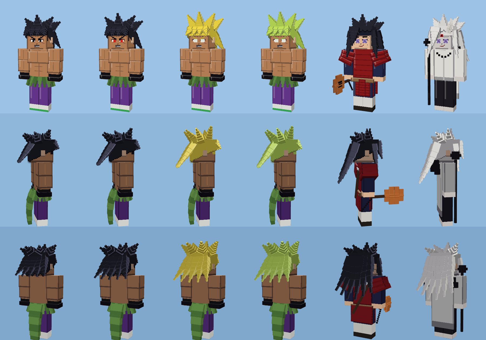

| الشخصية | الأطوار (القوة) | الشكل | القدرات |
|---|---|---|---|
| **برولي** (Dragon Ball Super) | عادي 160 ← الغاضب 300 ← سوبر سايان 470 ← **السوبر سايان الأسطوري (القوة الكاملة)** 630 | بشرة سمراء وعضلات ضخمة، ندبة على خده الأيسر وندبة X على صدره، بنطال بنفسجي، حذاء أبيض بأطراف خضراء، فرو أخضر حول خصره ينسدل خلفه، أساور سوداء، شعر بري حتى أعلى ظهره؛ يصير ذهبياً ثم **أخضر-ذهبي** وأعيناً بيضاء وجسماً أكبر في الأسطوري | Gigantic Roar، Eraser Cannon، Blaster Meteor، Gigantic Rush، Gigantic Hammer، Gigantic Press، Wrathful Rampage، Eraser Blow، **Omega Blaster**، Gigantic Impact |
| **مادارا أوتشيها** (Naruto) | المُبعث بالرينيغان 160 ← **السوسانو الكامل الأزرق** 195 ← **مستضيف العشرة ذيول (المسارات الستة)** 260 | المُبعث: صلبة رمادية وتشققات، رينيغان، شعر طويل شائك حتى الخصر يغطي عينه اليمنى، درع قرمزي، المروحة (غونباي) بسلسلتها، والمنجل على ظهره. المسارات الستة: شعر أبيض، رداء أبيض بست ماغاتاما، قرن على يسار جبهته، عين الرين شارينغان الثالثة، العصا السوداء وكرات البحث عن الحقيقة | Great Fire Annihilation، Majestic Destroyer Flame، Deep Forest Emergence، Wood Dragon، **Tengai Shinsei** (نيزكان من السماء، الثاني مخبأ خلف الأول)، Shinra Tensei، Uchiha Return (المروحة تردّ الضربات)، سيف السوسانو، Limbo، كرات البحث عن الحقيقة، Chibaku Tensei، **Infinite Tsukuyomi**، امتصاص الرينيغان |

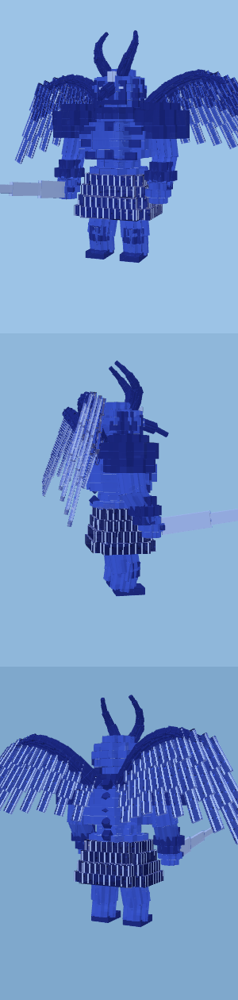

سوسانو مادارا الكامل **أزرق** ويبقى خلفه طوال الطور (~20 كتلة)، ويضرب بسيفه مع قدرة سيف السوسانو.

- **الشخصيات أقوى بكثير**: الدفاع صار يقسم الضرر على 6.5 (بدل 4) — المعارك أطول بكثير، والأقوى يبقى هو الفائز.
- **معركة فورية بأمر واحد**: `/scriptevent ab:vs goku vegeta` يُخرج الشخصيتين أمامك (14 كتلة) في فريقين ويبدأ القتال، و`/scriptevent ab:random` مواجهة عشوائية. الأسماء: goku, vegeta, gojo, yuji, yuji_final, sukuna, luffy, zoro, frieza, naruto_kid, naruto_teen, naruto_war, naruto_adult, sasuke_kid, sasuke, sasuke_war, sasuke_adult, ichigo, tanjiro, tanjiro_demon, muzan, broly, madara.
- **شاشة الفوز**: عندما ينتهي فريق، يظهر على الشاشة اسم الفائز وتحوّله مع صوت الفوز.

## الجديد في 1.11.0: قتال احترافي
- **أذكى**: حتى وهم قريبون من بعض يستخدمون قدراتهم وطاقتهم (الكومبو العادي صار أقل، والتقنيات أكثر). يختارون القدرات التي لم يستعملوها منذ مدة، ويفضّلون الضربات الكبيرة عندما يكون الخصم قوياً أو تقل صحتهم، **ويتفادون جانباً** عندما يرون الخصم يجهّز تقنية كبيرة من بعيد.
- **الدفع للخلف (1.11.1)**: كل ضربة قوية **تدفع الخصم نحو 7 كتل على الأرض — بلا طيران**: ينزلق للخلف بسرعة ثم يبطئ، والغبار يتطاير خلفه، وانفجار غبار حيث يتوقف (أو حين يصطدم بجدار)، ويتلخبط لحظة. وكل الضربات الأخرى (الانفجارات، الضربات حوله، الكومبو) صار رفعها للأعلى محدوداً جداً فلا أحد يطير.
- **أقوى ولا يموتون بسرعة**: كل الشخصيات صحتها 1000 ودفاعها يقسم الضرر على 4، فالمعارك صارت أطول بكثير (المتقاربون قد يقاتلون أكثر من دقيقة). والضرر حسب فرق القوة صار أنعم (الأقوى يبقى متفوقاً بلا أن يقتل في ضربتين).
- **التحولات خطوة خطوة**: لا أحد يقفز للتحول الأخير من البداية. يتحول عندما يتفوق عليه الشكل **الحالي** للخصم (للشكل الذي يجاريه فقط)، أو عندما تقل صحته، أو بعد تبادل طويل متكافئ. وكل تحول يعيد له قليلاً من القوة.
- **قدرات أوضح وأكبر**: كل المؤثرات صارت أكبر بـ30%.
- **قدرات جديدة لكل الشخصيات** (أكثر من 50): غوكو (Kiai، Ki Barrage، God Kamehameha، Ultra Instinct Kamehameha، Dragon Throw، Afterimage)، فيجيتا (Final Galick Cannon، Atomic Blast، Galaxy Breaker، Energy Barrier)، غوجو (Red الأقصى، كرات Blue الملاحقة، Infinity Barrage)، إيتادوري (Lariat، سلسلة Black Flash، Divergent Fist Barrage)، إيتادوري النهائي (Flowing Red Scale، Blood Meteorite)، سوكونا (Web، Max Elephant، Dismantle Barrage)، لوفي (Jet Pistol، Giant Pistol، Kong Organ، Dawn Whip، Dawn Rocket)، زورو (108 Pound Cannon، Tiger Hunt، Bull Needle)، فريزا (Death Wave، Death Storm، Death Chaser)، ناروتو (رمي الكوناي، ضربات الاستنساخ، قبضات كوراما، قنابل الوحش الصغيرة)، ساسكي (Chidori Katana)، إيتشيغو (Getsuga Barrage، Cero Getsuga).
- **إذا ضاع منك بيض أي شخصية**: اكتب `/scriptevent ab:kit` وتحصل على كل البيض والعصاتين من جديد.
- غوكو: صحته كانت 1800 (وفيجيتا 1700 وفريزا 1500) — أعلى من 1024 الذي قد لا يقبله ماين كرافت، وغالباً لهذا اختفى. صارت كل الصحة 1000 والقوة تأتي من الدفاع.

## الجديد في 1.10.0
### أشكال الكيوبي كما في الأنمي
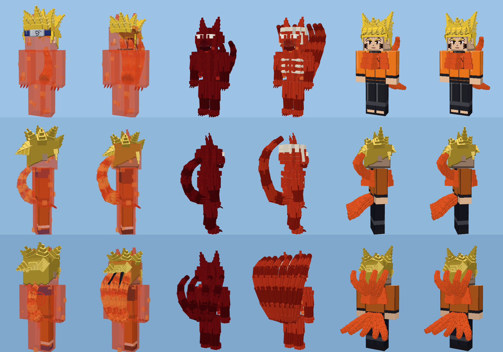

| الشكل | الشكل الخارجي |
|---|---|
| **V1** (ناروتو الصغير: ذيل واحد) | غلاف شاكرا أحمر **شفاف** يغطي جسمه كله وناروتو ظاهر من داخله، فقاعات تغلي، أذنا ثعلب، مخالب شاكرا؛ وعيونه حمراء بحدقة عمودية، شوارب أعرض، وأنياب |
| **V1 بثلاثة ذيول** (طور جديد لناروتو شيبودن، قوة 60) | نفس الغلاف الشفاف فوق ملابس شيبودن، بثلاثة ذيول |
| **V2** (أربعة ذيول) | جسد ثعلب منحوت من الشاكرا الحمراء الداكنة؛ **فك علوي وسفلي** بأسنان بيضاء مسننة وضوء أبيض داخل الفم، **والفك ينفتح عند الزئير** |
| **الذيول الثمانية** | أحمر برتقالي وعظام الكيوبي تنمو فوقه |
| **Baryon Mode** (مُصحح حسب الويكي) | خصلتا شعر كأذني ثعلب، أصباغ سوداء حول العينين، رداء شاكرا بدوامة سوداء على الصدر، و**تسعة ذيول** (أربعة من ظهر الرداء وخمسة من أسفله) بخط أسود في وسط كل ذيل |

وضع الكيوبي ووضع كوراما بلا ذيول (مثل الأنمي: قرون وعلامات ماغاتاما). وفي V1 وV2 والثمانية **يركض ناروتو على أربع** ويجثو كالوحش عند الوقوف.

### فكوك وحركات للعمالقة
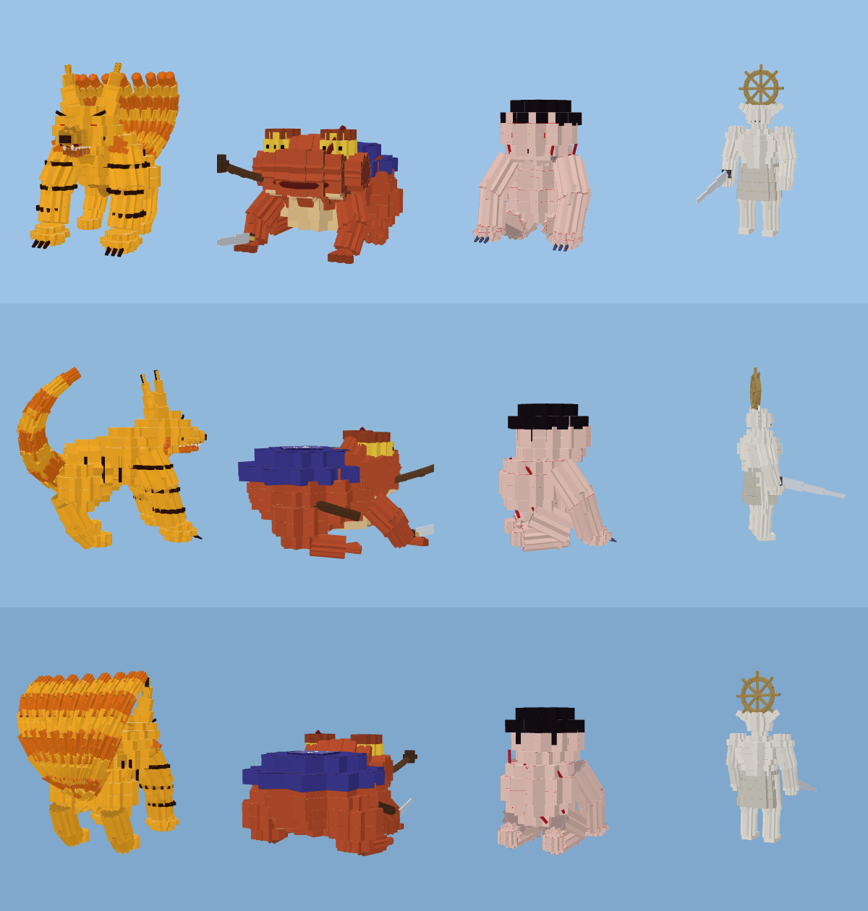

- **كوراما العملاق**: فك سفلي متحرك بأسنان ولسان، وأسنان على طول الفك العلوي وأنياب طويلة. حركات: **ضربة مخلب**، **دوران الذيول التسعة**، **العضّة** (الفك ينفتح والرأس يندفع)، ويفتح فمه عند تجميع Tailed Beast Bomb. قدرة جديدة لناروتو الحرب والهوكاجي: **Kurama Avatar Assault** (مخلب ← ذيول ← عضّة).
- **غامابونتا**: يقفز ويسحق الأرض، ثم **يضرب بالدوسو** (صار يمسكه بيده)، ثم **مدفع الماء** يخرج من فمه (فك متحرك).
- **السوسانو**: يضرب بقبضته مع كل تشيدوري لساسكي، وقدرة جديدة **Susanoo Onslaught**: السيف ← القبضة ← السهم.
- **رضيع موزان العملاق**: يقفز ويسحق ثم **يعض**.
- **ماهوراغا** (جديد لسوكونا): العملاق الأبيض بسيف الإبادة على ذراعه والعجلة ذات المقابض الثمانية تدور فوق رأسه — يضرب بالسيف ثم تدور العجلة (تكيّف) فيضرب ضربة ثقيلة.

### ضربات مميزة جديدة لكل الشخصيات
| الشخصية | الجديد |
|---|---|
| غوكو | **Solar Flare** (يعمي كل من حوله)، **Kamehameha ×10 Kaioken** (في SSB)، **Meteor Smash**، **Silver Dragon Flash** (في Ultra Instinct) |
| فيجيتا | **Final Impact**، **Gamma Burst Flash**، **Ultra Ego: Destruction Barrage** |
| غوجو | **Lapse Blue: Maximum Output** (يسحب كل شيء لنقطة ويسحقه)، **Black Flash** |
| إيتادوري | **Slaughter Demon** (سكين نانامي) |
| سوكونا | **Mahoraga**، **Nue** (طائر البرق)، **Divine Dogs** |
| لوفي | **Red Hawk**، **Jet Gatling**، **Culverin**، **Rhino Schneider**، **Black Mamba** |
| زورو | **Flying Dragon Blaze** (Hiryu Kaen)، **Black Rope Dragon Twister**، **Yakkodori** |
| فريزا | **Supernova**، **Death Psycho Bomb** |
| ناروتو | **Chakra Shroud Rush** (V1)، **Kurama Avatar Assault**، والضفدع صار يقاتل بالسيف ومدفع الماء |
| ساسكي | **Dragon Flame Jutsu**، **Demon Wind Shuriken** (الصغير)، **Susanoo Onslaught** |

اختُبر في بطولة كاملة بين الشخصيات الـ21: الأقوى فاز في **420 من 420** معركة بلا أي خطأ في السكربت.

## الجديد في 1.9.1: نحت أنعم وأدق
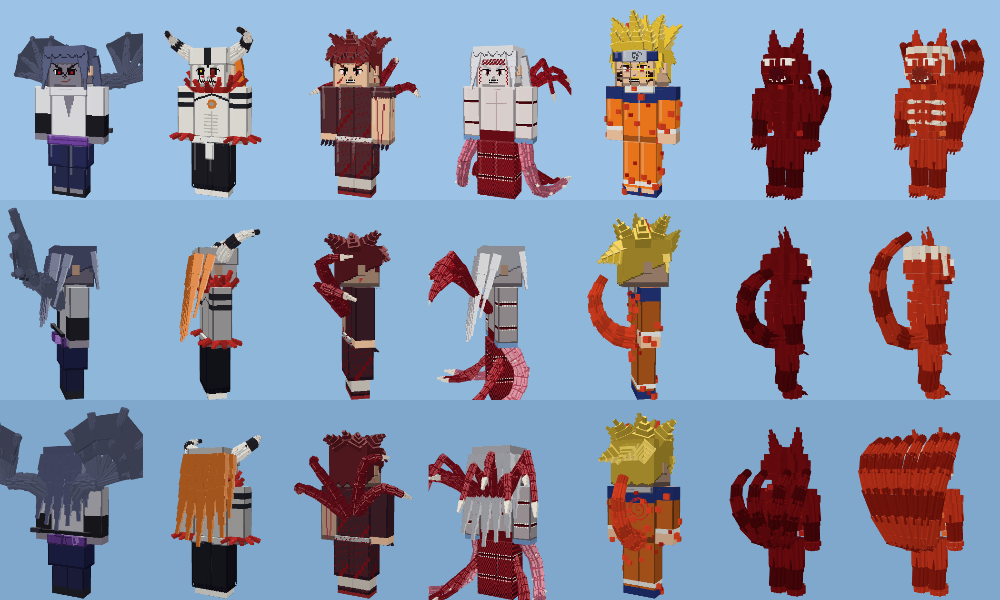

- **مقاطع دائرية**: كل جزء منحوت صار من ثلاث مكعبات مدارة حول محوره (مقطع بـ12 ضلعاً) بدل مكعبين متقاطعين، والأجسام البيضاوية كذلك — فالذيول والسياط والأطراف تبدو مستديرة لا مربعة.
- **تحكم كامل بالاتجاه**: كل مكعب يُوجَّه بدقة (حتى الريش والأغشية تواجه الاتجاه الصحيح)، وتحققتُ رياضياً أن كل جزء يشير حيث يجب.
- **ألوان مشتركة**: المكعبات المنحوتة تتشارك مربعات لون صغيرة، فالنسيج صار أصغر بكثير (كوراما من 1024 إلى 256) رغم زيادة عدد المكعبات — أخف على الجوال. والإضاءة يحسبها ماين كرافت حسب اتجاه كل سطح، فيظهر الشكل ناعماً.
- **ناروتو بالذيول الأربعة (V2)**: صار جسداً منحوتاً كاملاً لثعلب من الشاكرا الحمراء الداكنة: رأس مستدير بأذنين وخطم، عيون بيضاء مائلة بلا حدقة، فم أبيض مسنن، جسم وأطراف بمفاصل ومخالب، فقاعات شاكرا، وأربعة ذيول. **والذيول الثمانية** بلون أحمر برتقالي وتنمو فوقه عظام الكيوبي (الجمجمة والأضلاع والعمود الفقري).
- **ناروتو الصغير (عباءة الكيوبي)**: شاكرا حمراء تغلي حول جسمه بدل الصناديق، وأذنان من الشاكرا.
- **ساسكي بالختم الملعون 2**: أصابع قدميه صارت رمادية مثل وجهه ويديه (كانت بلون البشرة).
- **إيتشيغو (Vasto Lorde)**: فرو أحمر شائك حول الرقبة والمعصمين بدل الصناديق.
- **موزان**: أشواك عظمية بارزة على جانبي سياط الذراعين، وسياط جديدة من فخذيه.
- **تانجيرو الشيطان**: مخالب منحنية من أطراف أصابعه بدل المربعات.

## الجديد في 1.9.0
### تقنية المكعبات الكثيرة (مثل نماذج Blockbench الاحترافية)
كل الأشكال العملاقة والقدرات الملتصقة بالجسم صارت **منحوتة من مئات المكعبات الصغيرة المدمجة**: أجسام بيضاوية من طبقات متقاطعة، أطراف منحنية تتدرج في السماكة مع مفاصل وحلقات لونية، ريش وصفائح — بدون حواف سوداء، فتظهر كسطح واحد ناعم. (الأداة في `tools/sculpt.py`.)

### السوسانو من جديد — 3 مراحل وبالحجم الحقيقي، ويبقى مع ساسكي
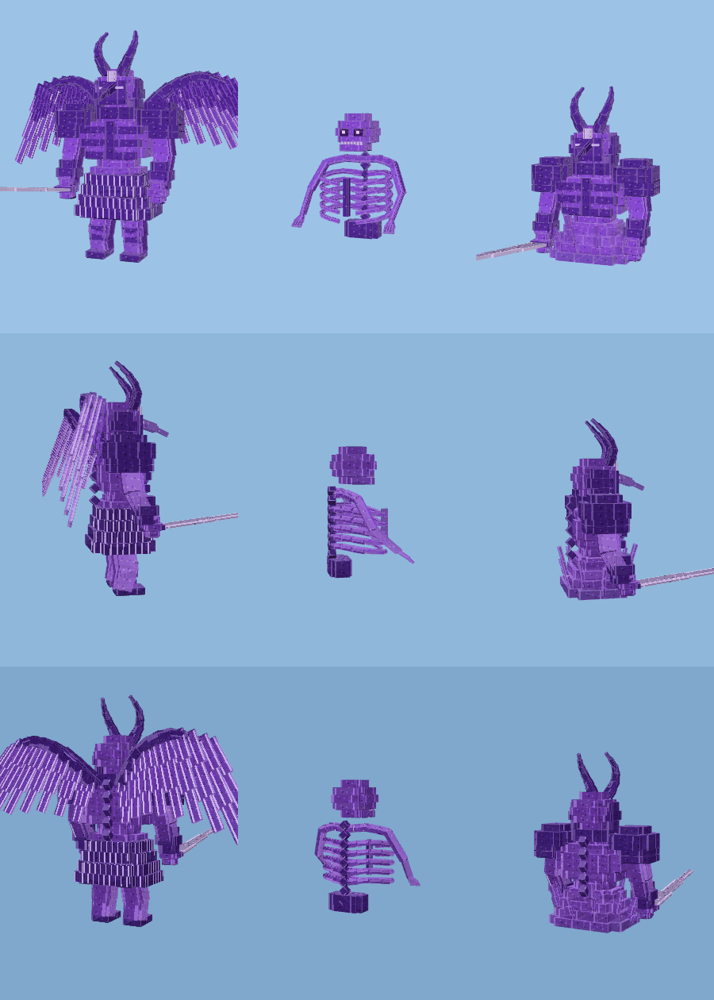

| المرحلة | متى | الشكل والحجم |
|---|---|---|
| **القفص الصدري** (مانغيكيو) | ساسكي شيبودن في طور السوسانو | عمود فقري، 5 أزواج أضلاع منحنية حوله، جمجمة بأسنان، ذراعان هيكليتان بأصابع (~3 كتل) |
| **السوسانو المدرّع** (الأبدي) | ساسكي الحرب في الطور الأول | جذع مدرّع بخوذة التينغو والهلال، أكتاف طبقات، قفازات، سيف، فوق قاعدة من لهب الشاكرا (~8 كتل) |
| **السوسانو الكامل** | ساسكي الحرب (الكامل والرينيغان) وساسكي الكبير | عملاق كامل بتنورة مدرّعة وساقين وجناحَي طائر بريش عريض وسيف ضخم (~**20 كتلة**) |

السوسانو صار **كياناً مستقلاً يلحق ساسكي** طوال الطور: الأولان يحيطان به، والكامل يقف خلفه شاهقاً. ويتحرك مع قدراته: يرفع السيف وينزله في **سيف سوسانو**، ويمد ذراعيه مصوّباً في **السهم** و**سهم إندرا**. ويختفي عند تغيّر الطور أو موت ساسكي. (أُزيلت الشبكة القديمة من جسم ساسكي.)

### كوراما وغامابونتا — منحوتان وبحجم كبير

- **كوراما** (~16 كتلة): جمجمة وخطم وفك بأنياب، عيون حمراء بحدقة عمودية وعلامات سوداء، أذنان طويلتان برأس أسود، أرجل بمخالب، أشرطة الختم السوداء، و**تسعة ذيول** كثيفة تلتف للأعلى.
- **غامابونتا** (~12 كتلة): جسد ورأس عريض، عيون جاحظة بحدقة أفقية، الندبة، الثآليل، الفم الطويل، الهاوري الأزرق بالكانجي، الغليون، أصابع مكففة، والخنجر على جنبه — ينزل على العدو مباشرة.

### القدرات الملتصقة بالجسم

ذيل الكيوبي (ناروتو الصغير)، الذيول الأربعة والثمانية (ناروتو شيبودن)، **أجنحة اليد** للختم الملعون 2 (ذراع بمفاصل، خمسة أصابع بمفاصل، وغشاء بينها)، وقرنا الـ Vasto Lorde — كلها منحوتة الآن.

### شخصيتان جديدتان: تانجيرو الشيطان وموزان
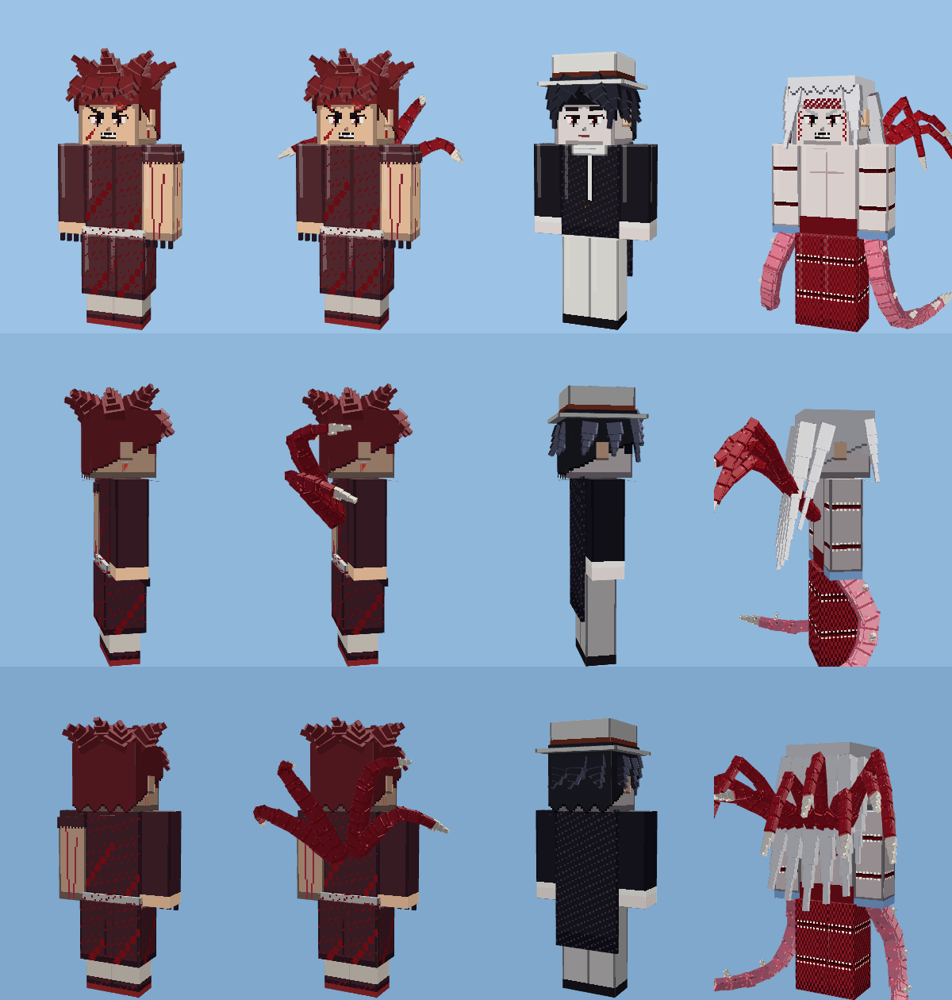

| الشخصية | الأطوار (القوة) | الشكل | القدرات |
|---|---|---|---|
| **تانجيرو الشيطان** | شيطان متوحش 66 ← ملك الشياطين قاهر الشمس 80 | عيون بحدقة عمودية، أنياب، علامات اللهب الثلاث (الجبين، الفك، والصدغ في الطور الثاني)، زي ملطخ بالدم بلا كم أيسر، مخالب، بلا هاوري ولا سيف؛ وفي الطور الثاني مجسات لحم بأطراف عظمية من ظهره | مخالب متوحشة، زئير الشيطان، العضّة (تشفيه)، نطحة الرأس الشيطانية، **مجسات اللحم**، **هيجان قاهر الشمس**، **تجديد شبه مطلق** |
| **موزان كيبوتسوجي** | موزان 72 ← **الشكل النهائي (المانغا)** 90 | الطور الأول: القبعة البيضاء والبدلة السوداء المطرزة وربطة العنق البيضاء والبنطال الأبيض، شعر أسود مموج وعيون حمراء بحدقة القط. الطور الثاني كما في المانغا: **شعر أبيض طويل**، أفواه بأسنان على أطرافه، كتلة حمراء متقشرة على جبينه وأسفل جسده، **سوطان ورديان بنصال عظمية من ذراعيه**، و**تسعة سياط حمراء** من ظهره | سياط الذراعين، **Black Blood: Brambles** (أشواك تقيّد الخصم)، **المفترس** (ذراع تتحول لفم عملاق يلتهم ويشفيه)، **دم ملك الشياطين** (يدمر الخلايا من الداخل، ويشلّ تانجيرو الشيطان لأنه من دمه)، **السياط التسعة**، **شفط الأفواه**، **موجة فم الصدر**، التجديد (خمسة أدمغة وسبعة قلوب)، و**الرضيع العملاق** (~10 كتل) عند اقتراب نهايته: ينتفخ لرضيع لحمي عملاق يسحق الأرض |

ترتيبهما: موزان (90) أقوى من تانجيرو الشيطان (80) وأقوى من كل شخصيات قاتل الشياطين، لكنه تحت ساسكي شيبودن بالسوسانو (98) وناروتو شيبودن (106) — اختُبر في المحاكاة.

## الجديد في 1.8.1: الاستدعاءات العملاقة

- **سوسانو الكامل** (ساسكي الحرب في طور سوسانو الكامل أو الرينيغان، وساسكي الكبير بالسوسانو): محارب بنفسجي شفاف بطول ~8 كتل، بخوذة التينغو والهلال والأجنحة المريشة. يظهر خلف ساسكي ويضرب بسيفه الضخم في **سيف سوسانو**، ويصوّب في **سهم سوسانو** و**سهم إندرا**.
- **كوراما** (ناروتو الحرب من وضع كوراما فما فوق، وناروتو الهوكاجي بالـ Kurama Link): الثعلب الذهبي العملاق بذيوله التسعة وعلامات الختم السوداء. ينهض خلف ناروتو ويرفع رأسه عند **Tailed Beast Bomb** و**Tailed Beast Rasenshuriken**.
- **غامابونتا**: الضفدع الزعيم بالهاوري الأزرق والغليون والندبة فوق عينه. يسقط على العدو ويقفز ويسحق الأرض عند **استدعاء غامابونتا**، ثم يطلق قذيفة الماء.
- تكبر من انفجار شاكرا، وتتحرك (ضربة السيف، التصويب، القفزة)، ثم تتلاشى وحدها.

## الجديد في 1.8.0
### غوكو وفيجيتا: سوبر سايان الإله (الشعر الأحمر)
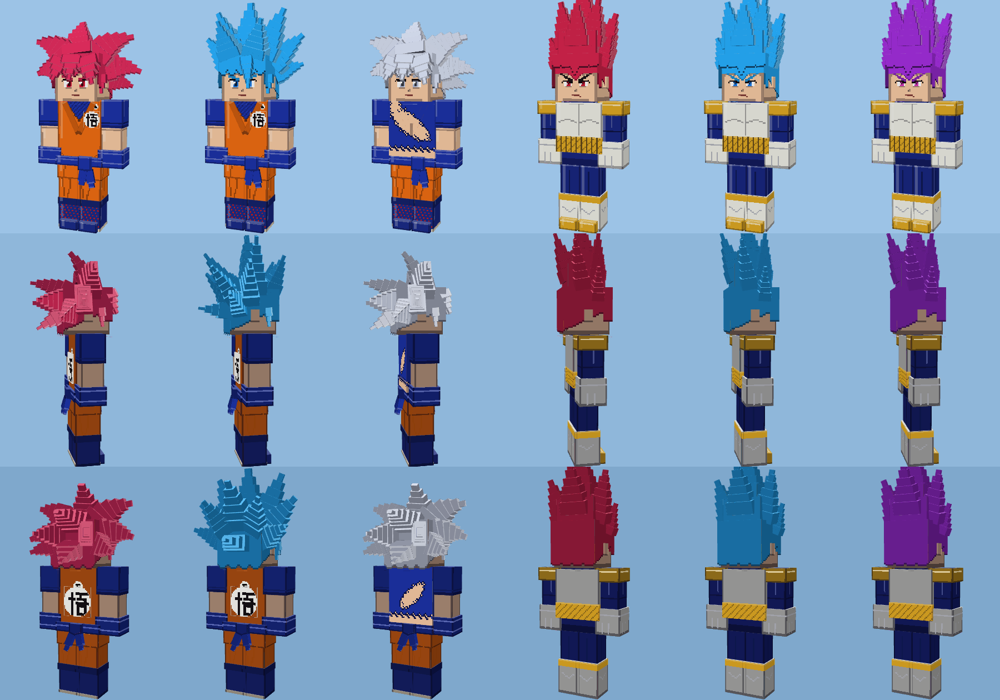

- غوكو: عادي 150 ← SSJ 220 ← SSJ3 300 ← **سوبر سايان الإله 420** ← SSB 560 ← **Ultra Instinct 850** (الأقوى في اللعبة).
- فيجيتا: عادي 140 ← SSJ 210 ← **سوبر سايان الإله 400** ← SSB 520 ← **Ultra Ego 680** (يرتفع حتى 748 بغضبه، ويبقى أقل من غوكو).
- فريزا الذهبي صار 480. وصحة الآلهة ارتفعت (غوكو 1800، فيجيتا 1700، فريزا 1500) لتناسب قوتهم الجديدة.
- **Hakai** فيجيتا لا يعمل بالكامل على من هو أقوى منه (30% فقط من الضرر) — مثل الأنمي.

### إيتشيغو: 7 أشكال وكل قدراته
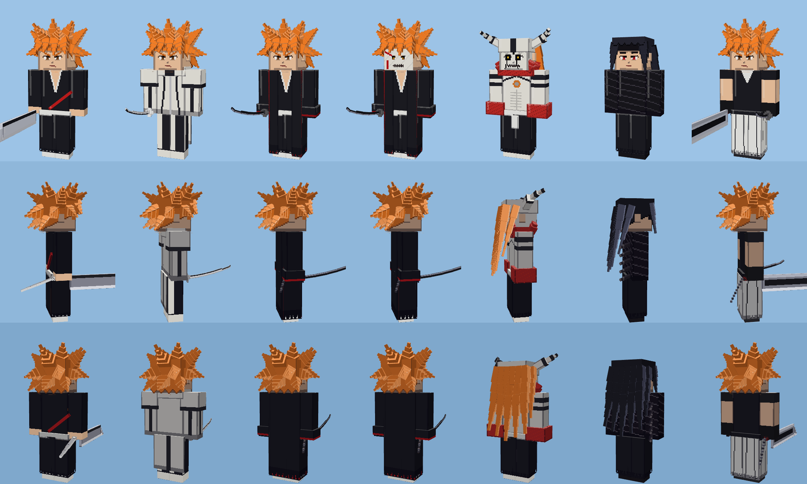

| الشكل (القوة) | الشكل الخارجي | القدرات |
|---|---|---|
| Shikai 90 | شعر برتقالي شائك، زانغيتسو الساطور العملاق بقماشه الأبيض | Getsuga Tensho الأزرق، **أرجحة زانغيتسو بالقماش** |
| Complete Fullbring 125 | البدلة البيضاء بالخطوط السوداء | **Bringer Light** (سرعة خارقة)، Fullbring Getsuga |
| Bankai 150 | المعطف الأسود الطويل الممزق ببطانة حمراء، Tensa Zangetsu السوداء بسلسلتها | Getsuga أسود-أحمر، **Getsuga Jujisho**، **Kuroi Getsuga**، Flash Step |
| قناع الهولو 200 | القناع الأبيض بالخطين الأحمرين، عيون سوداء بقزحية صفراء | Cero، Getsuga أحمر، **تجديد فوري** للجروح |
| **Vasto Lorde** 250 | جسد أبيض بعلامات سوداء، الثقب في الصدر، فرو أحمر، قرنان، شعر برتقالي طويل | **Sonido Claws**، **Cero من بين القرنين**، تجديد فوري |
| Mugetsu 300 | شعر أسود طويل، لفائف سوداء، عيون حمراء | **Mugetsu** (موجة سوداء عملاقة)، **يد واحدة** (يوقف الضربة بيده ويرد بضربة) |
| **Bankai الحقيقي** 360 | سيفان: الساطور الضخم بسلسلته + الشفرة القصيرة السوداء | **Getsuga Tensho بالسيفين**، Jujisho، Flash Step |

### ساسكي: 4 نسخ مثل ناروتو
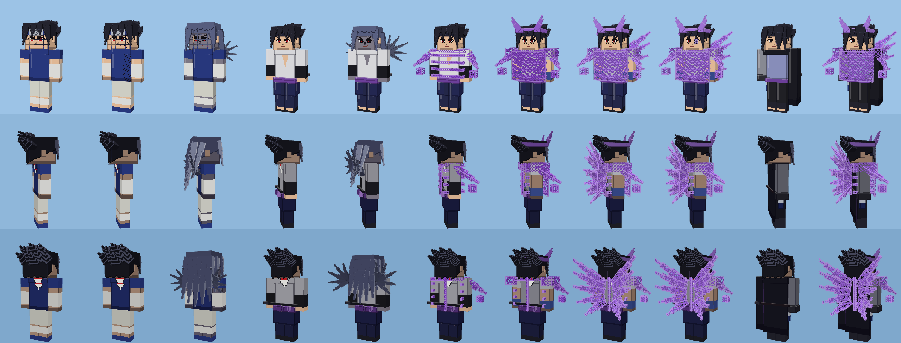

| النسخة | الأطوار (القوة) | القدرات |
|---|---|---|
| ساسكي الصغير (الجزء الأول) | شارينغان 24 ← الختم الملعون 1 (34) ← **الختم الملعون 2** بالأجنحة واليد والجلد الرمادي 50 | كرة النار العظيمة، **زهرة العنقاء** (5 كرات)، **Lion Combo**، Chidori، **Chidori الأسود** (بالختم) |
| ساسكي شيبودن | شارينغان 70 ← الختم الملعون 2 (80) ← مانغيكيو + سوسانو 98 | Chidori، **Chidori Spear**، **Chidori Senbon**، Chidori Current، Kirin، **جينجتسو الشارينغان**، Amaterasu، **Kagutsuchi**، سهم سوسانو |
| ساسكي الحرب | مانغيكيو الأبدي + سوسانو المدرع 150 ← **سوسانو الكامل بالأجنحة** 175 ← **رينيغان** 210 | كل ما سبق + **سيف سوسانو**، **Susanoo Chidori**، **Amenotejikara** (تبديل الأماكن)، **سهم إندرا** (بشاكرا الوحوش التسعة) |
| ساسكي الكبير | رينيغان 160 ← سوسانو الكامل 190 | Chidori، **Yin Release Lightning**، جينجتسو الرينيغان، Amenotejikara، Amaterasu، Kagutsuchi، سيف وسهم سوسانو |

ساسكي الكبير **بذراع واحدة** (فقد الذراع اليسرى في وادي النهاية) والعباءة السوداء تغطي مكانها، والغرة تغطي عين الرينيغان. السوسانو صار **شبكة شاكرا شفافة** (أضلاع، ذراعان هيكليتان، درع، قرنان، وأجنحة للكامل).

### ناروتو: كل التحولات

| النسخة | الأطوار (القوة) | قدرات جديدة |
|---|---|---|
| ناروتو الصغير | عادي 25 ← عباءة الكيوبي 45 | **استدعاء غامابونتا** (يسحق الأرض ويطلق قذيفة ماء) |
| ناروتو شيبودن | عادي 50 ← **الذيول الأربعة (V2)** 70 ← وضع الحكيم 88 ← **الذيول الثمانية** (هيكل الكيوبي) 106 | Rasenshuriken باليد، غامابونتا، **ذراع الشاكرا**، **زئير الشاكرا**، **قنبلة الوحش الصغيرة**، Tailed Beast Bomb، **وابل الراسينغان** |
| ناروتو الحرب | KCM 140 ← وضع كوراما 165 ← **الحكيم + كوراما** 190 ← حكيم المسارات الستة 240 | **Tailed Beast Rasenshuriken**، Super Big Ball Rasengan، **Lava Rasenshuriken**، **Magnet Rasengan**، **Planetary Rasengan**، **قوة الين-يانغ** (علاج) |
| ناروتو الهوكاجي | هوكاجي 150 ← **وضع الحكيم** 175 ← Kurama Link 210 ← Baryon 290 | Big Ball Rasengan، Frog Kumite، وابل الراسينغان، Tailed Beast Rasenshuriken |

### ناروتو ضد ساسكي (المقارنة الصحيحة)
- **الصغار**: ساسكي بالختم الملعون 2 (50) أقوى من ناروتو بعباءة الكيوبي (45) — في وادي النهاية الأول فاز ساسكي.
- **شيبودن**: ناروتو بالذيول الثمانية (106) أقوى من ساسكي بالسوسانو (98).
- **الحرب**: ناروتو حكيم المسارات الستة (240) أقوى من ساسكي بالرينيغان (210) — المعركة الأخيرة كانت متقاربة جداً.
- **الكبار**: ناروتو بالـ Baryon (290) أقوى بوضوح من ساسكي (190)، وساسكي نفسه يعترف أن ناروتو هو الأقوى.

اختُبر في المحاكاة: الفائز الصحيح في كل مواجهة.

### الدوامة الحمراء على ظهر ناروتو
الدوامة الحمراء على ظهر سترة ناروتو هي **شعار عشيرة أوزوماكي** (موجود في الأنمي هكذا على الظهر)، وليست ختم الكيوبي. **ختم الكيوبي الحقيقي على بطنه** ويظهر فقط عندما يدخل وضع شاكرا التسعة ذيول — وهو مرسوم فعلاً كدوامة سوداء على بطن أشكاله الذهبية.

### تانجيرو: شكل جديد مطابق للأنمي + 3 أطوار
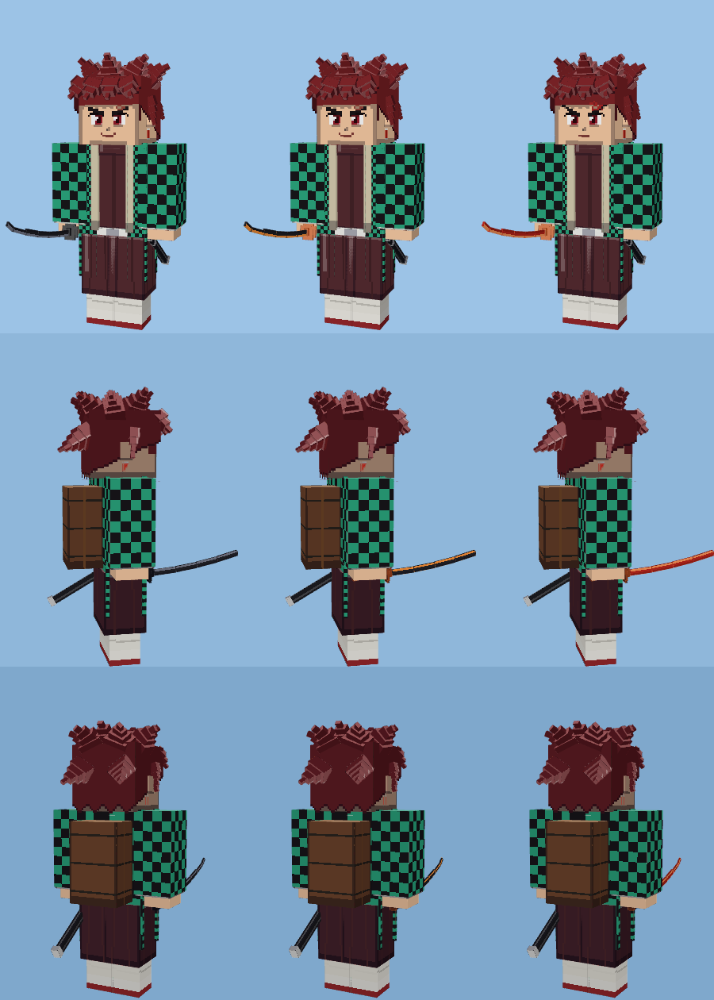

- الزي **العنابي الداكن** (ليس أسود)، البنطال الواسع، **لفائف الساق البيضاء**، الصندل الأحمر، الحزام الأبيض بالإبزيم، الهاوري المربعات الأخضر والأسود بأكمام واسعة، صندوق نيزوكو الخشبي بحمّالاته، الأقراط، الندبة، وغمد السيف على الورك الأيسر.
- الأطوار: تنفس الماء 40 ← **Hinokami Kagura** 50 ← **علامة قاتل الشياطين والسيف القرمزي** 62.
- قدرات جديدة: **Flowing Dance**، **Striking Tide**، **Drop Ripple Thrust**، **Waterfall Basin**، **Fire Wheel**، **Dragon Sun Halo Head Dance**، **Burning Bones Summer Sun**، **Setting Sun Transformation**، **الشكل الثالث عشر** (كل الرقصات الاثنتي عشرة متصلة)، و**نطحة الرأس** الشهيرة (تدوّخ الخصم).

## الإصدارات السابقة: ناروتو + ساسكي + إيتشيغو + تانجيرو

**نسخ الظل** عند ناروتو مقاتلون حقيقيون في نفس الفريق، يختفون بسحابة دخان عند أول ضربة، ويختفون كلهم إذا سقط ناروتو.

**قدرات جديدة للشخصيات القديمة:**
- غوكو: **Instant Kamehameha** (يشحن، ينتقل لحظياً بجانب الخصم ويطلق من مسافة صفر)، وفي **Ultra Instinct** كل مراوغة يتبعها هجوم مضاد تلقائي.
- غوجو: **Hollow Purple 200%** بالتعويذة الكاملة (في طور العيون)، أكبر وأقوى بكثير من العادي.
- زورو (ملك الجحيم): **Rengoku Oni Giri** — ثلاث قطعات تترك نيراناً سوداء تحرق الخصم.
- إيتادوري: **Black Flash** كقدرة مستقلة (ضربة ×2.5 مع برق أحمر وأسود).
- تانجيرو: **نيزوكو** تخرج من الصندوق عندما تنخفض صحته تحت 40% وتطلق **الدم المتفجر** (نيران وردية تحرق الأعداء حوله).
- تانجيرو: **Dead Calm** (الشكل الحادي عشر) — لثانيتين يصد 70% من كل ضربة ويرد عليها بقطعة.
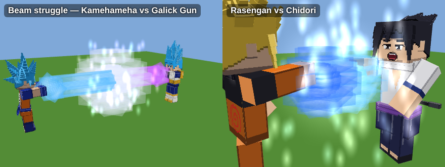

- **Rasengan ضد Chidori**: إذا هاجم ناروتو ساسكي بالراسينغان، ساسكي يرد بالتشيدوري، يندفعان نحو بعض ويتصادمان في المنتصف بانفجار ضخم، والأقوى يربح.
- **صدام النطاقات** (شينجوكو): إذا فتح غوجو Unlimited Void وسوكونا قريب وفارغ، يرد بـ Malevolent Shrine (والعكس)، يتدافع النطاقان، والأقوى يصمد والآخر يتحطم ويتوقف تأثيره.
- **صدام هاكي الملوك**: إذا أطلق لوفي هاكي الملوك وزورو (ملك الجحيم) قريب في الفريق الآخر، يطلق زورو هاكيه أيضاً، يتطاير برق أسود وأحمر بينهما، والأضعف يتجمد للحظة.
- ساسكي: **سوسانو** يمتص 15% من كل ضربة في طوره الثاني. إيتشيغو: **البانكاي** يرفع سرعة مراوغته.
- **جمل الدخول**: عند إخراج الشخصية من البيضة تقول جملتها (ناروتو: "Believe it!"، غوكو: "Hey, it's me, Goku!"...). وتشيدوري ساسكي يشل الخصم للحظة.
- **جمل التحول**: كل شخصية تقول جملتها الشهيرة عند التحول (إيتشيغو: "BAN... KAI!"، غوكو: "...and this is to go even further beyond!"، زورو: "I am the King of Hell"...).
- **قفل السيوف**: عندما يضرب سيّاف (زورو، إيتشيغو، تانجيرو، ساسكي) سيّافاً آخر قد تتلاقى الشفرتان بشرر ويُدفع الاثنان للخلف.
- **صراع الأشعة**: إذا أطلق مقاتلان شعاعاً على بعض في نفس اللحظة يتصادمان في المنتصف، والأقوى يدفع نقطة الاصطدام حتى تنفجر على الأضعف. غوكو وفيجيتا وفريزا وإيتشيغو (بالقناع) يردون على الشعاع بشعاعهم الخاص (كاميهاميها، Galick Gun، Death Beam، Cero).

## الحركات والتعابير

- **أربعة وجوه لكل شكل**: عادي، صراخ (عند استخدام قدرة أو تحول أو الضربة الأخيرة في الكومبو)، ألم (عند تلقي ضربة، مع ارتداد للخلف)، ورمش تلقائي كل بضع ثوانٍ.
- **وقفة قتال** عند دخول فريق: القبضة الأمامية ممدودة والخلفية عند الصدر، مع ارتداد خفيف.
- **وقفات مميزة**: فيجيتا وفريزا وسوكونا يكتّفون أيديهم خارج القتال، غوجو بوقفة مسترخية، فريزا يطفو فوق الأرض وذيله يتمايل، غوكو يحك رأسه، ولوفي لا يهدأ ويقفز في مكانه.
- **التحول** بأسلوب دراغون بول: انحناء، ذراعان للأسفل والخارج، رأس للخلف، صراخ وارتجاف.
- **حركات خاصة**: إصبعان على الجبين للانتقال اللحظي، يد أمام الوجه لـ Unlimited Void، ذراعان مفتوحتان لشحن Final Flash، إصبع واحد للأعلى لـ Death Ball، دوران زورو في Tatsumaki.
- **الضربات متحركة**: كل لكمة وركلة تبدأ بسحب ثم انطلاق سريع، وزورو يقاتل بقطعات سيف يمين ويسار وقطعة X بالسيفين، وسوكونا وإيتادوري (Modulo) يقطعان بحافة الكف، وفريزا يدور ويجلد بذيله، ووابل الطاقة عند فيجيتا بيدين متناوبتين.
- **سيوف زورو** كما في الأنمي: وادو إيتشيمونجي (مقبض أبيض بمعينات سوداء وحارس دائري)، سانداي كيتيتسو (مقبض أحمر وحارس رباعي وخط تموج على النصل)، إنما (مقبض بنفسجي بحلقات ذهبية وحارس بثلاث دوائر)، بنصل منحني والأغماد الثلاثة على الخصر. في شكل ملك الجحيم يربط الباندانا السوداء على رأسه.
- بيض الشخصيات يظهر عليه **وجه الشخصية**.
  
- **حركة لكل جير عند لوفي**: الجير 2 ينحني ويضخ الدم، الجير 3 و4 يعض ذراعه وينفخ، الجير 5 يضحك وذراعاه مفتوحتان. ومسدس المطاط يرجع للخلف أولاً ثم ينطلق، وكذلك البازوكا.
- **شحن الكي**: غوكو وفيجيتا وفريزا يتوقفون ويصرخون لشحن الطاقة عندما تنخفض.
- **دخول وفوز**: عند إخراج الشخصية من البيضة تقوم بحركتها المميزة، وعند هزيمة الخصم: فيجيتا وفريزا يكتّفان أيديهما، لوفي يضحك، غوجو وسوكونا يعملان إشارة اليد، والباقي يرفع قبضته.
- **Ultra Instinct**: قميص غوكو البرتقالي ممزق ويظهر القميص الأزرق المقطوع كما في نهاية بطولة القوة.
- **الكاميهاميها** تُقال مقطعاً مقطعاً (Ka... me... ha... me... HA!)، وGalick... GUN!!
- **الأطوال**: فيجيتا أقصر من غوكو، غوجو أطول، زورو أطول قليلاً، فريزا أقصر، وسوكونا في شكله الحقيقي أضخم.
- **تحولات بأسلوب كل شخصية**: زورو يربط الباندانا على رأسه، غوجو ينزع العصابة عن عينيه، غوكو يدخل Ultra Instinct بهدوء بلا صراخ، والباقي بصرخة التحول.
- **الجير 5 كرتوني**: عيونه تخرج من رأسه عند الصراخ وجسمه يتمطط كالمطاط.
- شريط **الطاقة** تحت شريط الصحة، والمهزوم يسقط بوجه متألم، والمراوغة تظهر كميلان سريع للجسم.
- **تفاصيل أخيرة**: فريزا يتحول للذهبي داخل شرنقة من الضوء الذهبي، عيون غوجو الستة تلمع بالأزرق أثناء القتال، رمش غوجو برموش بيضاء، وكل شخصية تظهر بانفجار طاقة بلونها عند خروجها من البيضة. تحت 20% من الصحة تترنح الشخصية من الألم أحياناً.
- **صرخات مميزة**: فيجيتا يصرخ بأسنان مطبقة، سوكونا يضحك بأنيابه، غوجو يبتسم بثقة، وزورو يعض على وادو.

## القدرات
**غوكو** (قوة 150 ثم 850): Ki Blast، كاميهاميها، الانتقال اللحظي، كايوكن، ضربة التنين (من SSJ3)، قنبلة الروح (عند الضعف). تفادي 10%، وفي Ultra Instinct 60%.
التحولات: Base ← Super Saiyan ← SSJ3 ← Super Saiyan God ← SSB ← Ultra Instinct

**فيجيتا** (140 ثم 680): وابل طاقة، Galick Gun، Big Bang Attack، Final Flash (من SSJ)، Hakai (في Ultra Ego)، اندفاع سريع. في Ultra Ego يزيد ضرره كلما تلقى ضرراً (حتى +60%).
التحولات: Base ← Super Saiyan ← Super Saiyan God ← SSB ← Ultra Ego

**غوجو** (100 ثم 115): **Infinity** يوقف كل الضربات ويستهلك طاقة لعنية (كلما كان المهاجم أقوى زاد الاستهلاك)، Blue (سحب)، Red (دفع وانفجار)، Hollow Purple (يمحو ما في طريقه)، **Unlimited Void** (نطاق 14 كتلة يشلّ الأعداء ويصيبهم إصابة مؤكدة، والأقوى منه يُشلّ وقتاً أقصر)، Reverse Cursed Technique (علاج)، انتقال، Black Flash.
بعد النطاق يدخل **Burnout** لمدة 8 ثوانٍ بلا تقنيات وبلا Infinity، كما في الأنمي.

**زورو** (95 ثم 146): Oni Giri (اندفاع وثلاث قطعات)، Tatsumaki (إعصار قطعات أخضر)، 36 Pound Phoenix (قطعة طائرة بعيدة المدى)، Shishi Sonson (ضربة استلال خاطفة)، **Kyutoryu Asura** (وهم الشيطان بثلاثة رؤوس وتسعة سيوف)، وفي شكل **ملك الجحيم**: Three Thousand Worlds بهاكي أسود وأحمر. عينه اليسرى مغلقة بالندبة، ويحمل إنما وكيتيتسو وفي فمه وادو إيتشيمونجي.

**فريزا** (180 ثم 480): Death Beam (شعاع إصبع رفيع)، وابل Death Beam، **Death Ball** (كرة عملاقة يرفعها فوق رأسه)، Death Saucer (قرصان قاطعان)، Nova Strike (اندفاع وانفجار)، التحريك الذهني (يرفع الخصم ويضربه بالأرض)، وفي **الشكل الذهبي**: Golden Death Beam. Black Frieza غير مضاف عمداً لأنه سيكون أقوى من غوكو، والذهبي تحت SSB.

الترتيب في المحاكاة (10 معارك لكل مواجهة): غوكو هزم غوجو 10 من 10، وفيجيتا هزم غوجو 10 من 10، وغوكو هزم فيجيتا 8 من 10.

## أوامر اختيارية
- `/scriptevent ab:griefing off`: القدرات لا تكسّر الكتل.
- `/scriptevent ab:fx low`: مؤثرات أخف للجوال.
- `/scriptevent ab:regen off`: الخراب يبقى ولا ترجع الساحة.
- `/scriptevent ab:cinema off`: بدون لقطات الكاميرا السينمائية.
- `/scriptevent ab:war 4`: حرب فرق 4 ضد 4 (من 2 إلى 6).

## للمطورين
- `python3 tools/build.py` يولّد الموديلات والنسيج ويبني `dist/AnimeBattles.mcaddon`.
- `tools/sim/` محاكاة للسكربت خارج اللعبة (نسخ `main.js` إلى `main.mjs` مع استبدال الاستيراد بـ `./mock.mjs`).
- مع كل إصدار جديد ارفع `version` في `BP/manifest.json` و`RP/manifest.json` (والاعتماد المتبادل بينهما)، وإلا قد يتجاهل ماين كرافت التحديث عند الاستيراد.
- كل شكل له أربع خامات: `<form>.png` و`<form>_shout.png` و`<form>_hurt.png` و`<form>_blink.png`، يختار بينها الـ render controller عبر الخاصية `ab:expr` (والرمش تلقائي).

## ترتيب القوة (الأقوى يفوز دائماً)
| الترتيب | الشخصية | القوة (أقصى شكل) |
|---|---|---|
| 1 | غوكو (Ultra Instinct) | 850 |
| 2 | **برولي (الأسطوري، بكامل غضبه)** | 640 ← 794 |
| 3 | فيجيتا (Ultra Ego، مع الغضب) | 680 ← 748 |
| 4 | فريزا (الذهبي) | 480 |
| 5 | إيتشيغو (Bankai الحقيقي) | 360 |
| 6 | ناروتو الهوكاجي (Baryon Mode) | 290 |
| 7 | **مادارا (المسارات الستة)** | 260 |
| 8 | ناروتو الحرب (حكيم المسارات الستة) | 240 |
| 9 | ساسكي الحرب (رينيغان) | 210 |
| 10 | ساسكي الكبير (سوسانو الكامل) | 190 |
| 11 | لوفي (Gear 5) | 170 |
| 12 | إيتادوري (Modulo) | 154 |
| 13 | زورو (ملك الجحيم) | 146 |
| 14 | سوكونا (الشكل الحقيقي) | 132 |
| 15 | غوجو (Six Eyes) | 115 |
| 16 | ناروتو شيبودن (الذيول الثمانية) | 106 |
| 17 | ساسكي شيبودن (سوسانو) | 98 |
| 18 | موزان (الشكل النهائي) | 90 |
| 19 | تانجيرو الشيطان (قاهر الشمس) | 80 |
| 20 | تانجيرو (العلامة) | 62 |
| 21 | ساسكي الصغير (الختم الملعون 2) | 50 |
| 22 | ناروتو الصغير (عباءة الكيوبي) | 45 |
| 23 | إيتادوري العادي | 35 |

قاعدة اللعب: الضرر يتضاعف بفرق القوة (أُس 3)، والشخصية تتحول فوراً للشكل المناسب إذا كان خصمها أقوى (للشكل الذي يتفوق على أقصى قوة خصمها بهامش 20%). آخر بطولة كاملة (1.12.0) بين الشخصيات الـ23: الأقوى فاز في **253 من 253** مواجهة (بعد تعديل علاج موزان)، بلا أي خطأ في السكربت.
