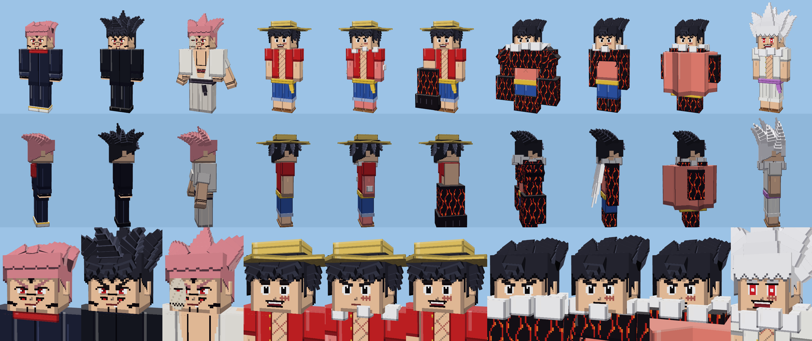
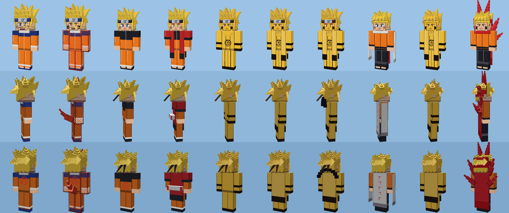
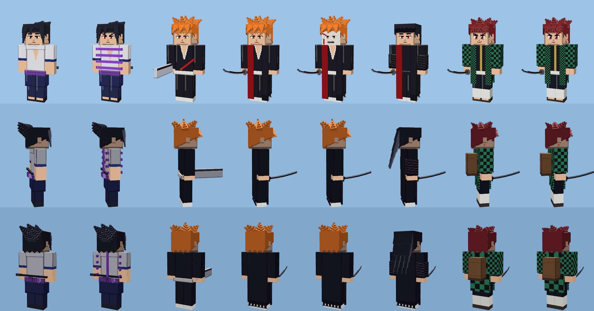
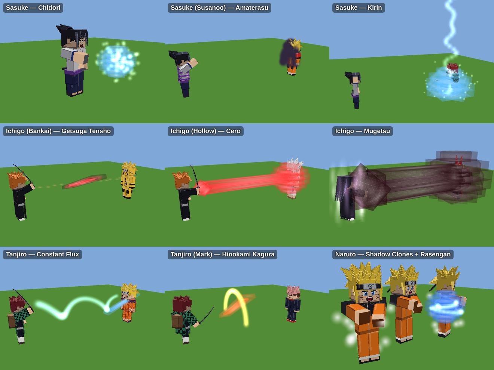
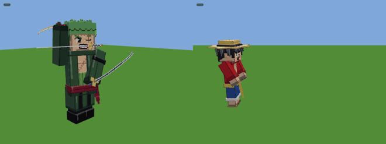
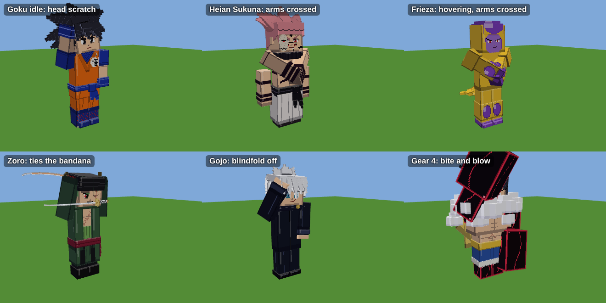
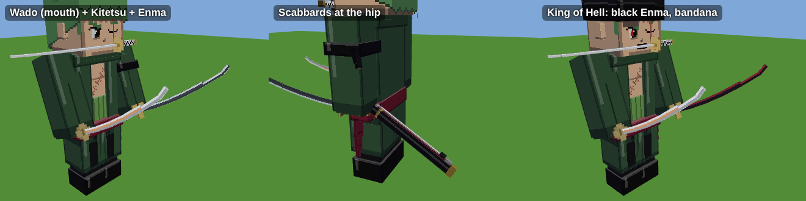
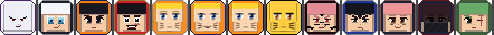

# Anime Battles — إضافة ماين كرافت بيدروك

غوكو، فيجيتا، غوجو، إيتادوري (العادي والنهائي)، سوكونا (جسد إيتادوري ← جسد ميغومي ← الشكل الحقيقي)، ولوفي بكل الجيرات، **زورو** (أسلوب السيوف الثلاثة ← ملك الجحيم) و**فريزا** (الشكل النهائي ← الذهبي) — بدقة 128×128، مع نظام فريقين وعصا قتل.

## التثبيت على الجوال
1. حمّل الملف `dist/AnimeBattles.mcaddon`.
2. افتحه، وماين كرافت يستورد الحزمتين تلقائياً.
3. أنشئ عالماً (أو عدّل عالماً) وفعّل الحزمتين **Anime Battles BP** و**Anime Battles RP**.
4. ادخل العالم. أول مرة تحصل على العصاتين وبيض الشخصيات الثلاث تلقائياً، وهي موجودة أيضاً في قائمة الإبداع (Creative).

النسخة المطلوبة: بيدروك 1.26.50 أو أحدث. نسخة الإضافة الحالية **1.7.0**؛ إذا قال ماين كرافت إن الحزمة مثبتة مسبقاً، احذف الحزمتين القديمتين من الإعدادات ← التخزين ثم استورد الملف من جديد.

## العصاتان
| العصا | الضرب | الاستخدام (ضغطة مطولة) | انحناء + استخدام |
|---|---|---|---|
| **Team Stick** | أول ضربة: أحمر، الضربة الثانية: أزرق (بالتناوب) | تبديل الفريق التالي | مسح كل الفرق |
| **Kill Stick** | قتل فوري ونهائي لأي مخلوق، حتى الواردن | تشغيل أو إيقاف تكسير الكتل بالقدرات | جودة المؤثرات: كاملة أو منخفضة للجوالات الضعيفة |

- القتال يبدأ تلقائياً بين الأحمر والأزرق، ولا أحد يهاجم فريقه.
- فوق كل مقاتل: الاسم، الفريق، التحول الحالي، **شريط الصحة**، والطاقة (KI أو CE).
- المخلوقات العادية تشارك أيضاً، لكن بقتال بسيط (تمشي نحو العدو وتضرب).
- لا تتأذى أنت من القدرات إلا إذا أدخلت نفسك في فريق.

## ناروتو (4 أعمار) + ساسكي + إيتشيغو + تانجيرو

| الشخصية | الأطوار (القوة) | القدرات |
|---|---|---|
| ناروتو صغير (الجزء الأول) | عادي 25 ← عباءة التسعة ذيول 45 | استنساخ الظل، Uzumaki Barrage، Rasengan، مخلب وزئير الكيوبي |
| ناروتو شيبودن | عادي 50 ← وضع الحكيم 85 | استنساخ متعدد، Rasengan، Big Ball Rasengan، Rasenshuriken، Frog Kumite |
| ناروتو الحرب | شاكرا التسعة ذيول 120 ← وضع كوراما 150 ← حكيم المسارات الستة 182 | Rasenshuriken، أذرع الشاكرا، Tailed Beast Bomb، مخالب كوراما، كرات البحث عن الحقيقة، Ultra Big Ball Rasenshuriken |
| ناروتو الهوكاجي السابع | هوكاجي 125 ← Kurama Link 165 ← Baryon 230 | استنساخ، Rasengan، Rasenshuriken، Tailed Beast Bomb، لكمة Baryon، Baryon Rush |
| ساسكي (شيبودن) | شارينغان 70 ← مانغيكيو + سوسانو 98 | Chidori، كرة النار العظيمة، Chidori Current (يشل الأعداء)، Kirin (صاعقة من السماء)، Amaterasu (نيران سوداء لا تنطفئ)، سهم سوسانو |
| إيتشيغو (بليتش) | Shikai 90 ← Bankai 150 ← قناع الهولو 200 ← Mugetsu 270 | Getsuga Tensho، Getsuga Jujisho، Flash Step، Cero (بالقناع)، Mugetsu (موجة سوداء عملاقة) |
| تانجيرو (قاتل الشياطين) | تنفس الماء 40 ← تنفس الشمس + العلامة 60 | Water Surface Slash، Water Wheel، Constant Flux (تنين الماء)، Hinokami Kagura، Clear Blue Sky، Sunflower Thrust |

**نسخ الظل** عند ناروتو مقاتلون حقيقيون في نفس الفريق، يختفون بسحابة دخان عند أول ضربة، ويختفون كلهم إذا سقط ناروتو.

**قدرات جديدة للشخصيات القديمة:**
- غوكو: **Instant Kamehameha** (يشحن، ينتقل لحظياً بجانب الخصم ويطلق من مسافة صفر)، وفي **Ultra Instinct** كل مراوغة يتبعها هجوم مضاد تلقائي.
- غوجو: **Hollow Purple 200%** بالتعويذة الكاملة (في طور العيون)، أكبر وأقوى بكثير من العادي.
- زورو (ملك الجحيم): **Rengoku Oni Giri** — ثلاث قطعات تترك نيراناً سوداء تحرق الخصم.
- إيتادوري: **Black Flash** كقدرة مستقلة (ضربة ×2.5 مع برق أحمر وأسود).
- تانجيرو: **Dead Calm** (الشكل الحادي عشر) — لثانيتين يصد 70% من كل ضربة ويرد عليها بقطعة.
- **صراع الأشعة**: إذا أطلق مقاتلان شعاعاً على بعض في نفس اللحظة يتصادمان في المنتصف، والأقوى يدفع نقطة الاصطدام حتى تنفجر على الأضعف. غوكو وفيجيتا وفريزا وإيتشيغو (بالقناع) يردون على الشعاع بشعاعهم الخاص (كاميهاميها، Galick Gun، Death Beam، Cero).

## الحركات والتعابير

- **أربعة وجوه لكل شكل**: عادي، صراخ (عند استخدام قدرة أو تحول أو الضربة الأخيرة في الكومبو)، ألم (عند تلقي ضربة، مع ارتداد للخلف)، ورمش تلقائي كل بضع ثوانٍ.
- **وقفة قتال** عند دخول فريق: القبضة الأمامية ممدودة والخلفية عند الصدر، مع ارتداد خفيف.
- **وقفات مميزة**: فيجيتا وفريزا وسوكونا يكتّفون أيديهم خارج القتال، غوجو بوقفة مسترخية، فريزا يطفو فوق الأرض وذيله يتمايل، غوكو يحك رأسه، ولوفي لا يهدأ ويقفز في مكانه.
- **التحول** بأسلوب دراغون بول: انحناء، ذراعان للأسفل والخارج، رأس للخلف، صراخ وارتجاف.
- **حركات خاصة**: إصبعان على الجبين للانتقال اللحظي، يد أمام الوجه لـ Unlimited Void، ذراعان مفتوحتان لشحن Final Flash، إصبع واحد للأعلى لـ Death Ball، دوران زورو في Tatsumaki.
- **الضربات متحركة**: كل لكمة وركلة تبدأ بسحب ثم انطلاق سريع، وزورو يقاتل بقطعات سيف يمين ويسار وقطعة X بالسيفين، وسوكونا وإيتادوري (Modulo) يقطعان بحافة الكف، وفريزا يدور ويجلد بذيله، ووابل الطاقة عند فيجيتا بيدين متناوبتين.
- **سيوف زورو** كما في الأنمي: وادو إيتشيمونجي (مقبض أبيض بمعينات سوداء وحارس دائري)، سانداي كيتيتسو (مقبض أحمر وحارس رباعي وخط تموج على النصل)، إنما (مقبض بنفسجي بحلقات ذهبية وحارس بثلاث دوائر)، بنصل منحني والأغماد الثلاثة على الخصر. في شكل ملك الجحيم يربط الباندانا السوداء على رأسه.
- بيض الشخصيات يظهر عليه **وجه الشخصية**.
  
- **حركة لكل جير عند لوفي**: الجير 2 ينحني ويضخ الدم، الجير 3 و4 يعض ذراعه وينفخ، الجير 5 يضحك وذراعاه مفتوحتان. ومسدس المطاط يرجع للخلف أولاً ثم ينطلق، وكذلك البازوكا.
- **شحن الكي**: غوكو وفيجيتا وفريزا يتوقفون ويصرخون لشحن الطاقة عندما تنخفض.
- **دخول وفوز**: عند إخراج الشخصية من البيضة تقوم بحركتها المميزة، وعند هزيمة الخصم: فيجيتا وفريزا يكتّفان أيديهما، لوفي يضحك، غوجو وسوكونا يعملان إشارة اليد، والباقي يرفع قبضته.
- **Ultra Instinct**: قميص غوكو البرتقالي ممزق ويظهر القميص الأزرق المقطوع كما في نهاية بطولة القوة.
- **الكاميهاميها** تُقال مقطعاً مقطعاً (Ka... me... ha... me... HA!)، وGalick... GUN!!
- **الأطوال**: فيجيتا أقصر من غوكو، غوجو أطول، زورو أطول قليلاً، فريزا أقصر، وسوكونا في شكله الحقيقي أضخم.
- **تحولات بأسلوب كل شخصية**: زورو يربط الباندانا على رأسه، غوجو ينزع العصابة عن عينيه، غوكو يدخل Ultra Instinct بهدوء بلا صراخ، والباقي بصرخة التحول.
- **الجير 5 كرتوني**: عيونه تخرج من رأسه عند الصراخ وجسمه يتمطط كالمطاط.
- شريط **الطاقة** تحت شريط الصحة، والمهزوم يسقط بوجه متألم، والمراوغة تظهر كميلان سريع للجسم.
- **تفاصيل أخيرة**: فريزا يتحول للذهبي داخل شرنقة من الضوء الذهبي، عيون غوجو الستة تلمع بالأزرق أثناء القتال، رمش غوجو برموش بيضاء، وكل شخصية تظهر بانفجار طاقة بلونها عند خروجها من البيضة. تحت 20% من الصحة تترنح الشخصية من الألم أحياناً.
- **صرخات مميزة**: فيجيتا يصرخ بأسنان مطبقة، سوكونا يضحك بأنيابه، غوجو يبتسم بثقة، وزورو يعض على وادو.

## القدرات
**غوكو** (قوة 150 ثم 430): Ki Blast، كاميهاميها، الانتقال اللحظي، كايوكن، ضربة التنين (من SSJ3)، قنبلة الروح (عند الضعف). تفادي 10%، وفي Ultra Instinct 60%.
التحولات: Base ← Super Saiyan ← SSJ3 ← SSB ← Ultra Instinct

**فيجيتا** (140 ثم 360): وابل طاقة، Galick Gun، Big Bang Attack، Final Flash (من SSJ)، Hakai (في Ultra Ego)، اندفاع سريع. في Ultra Ego يزيد ضرره كلما تلقى ضرراً (حتى +60%).
التحولات: Base ← Super Saiyan ← SSB ← Ultra Ego

**غوجو** (100 ثم 115): **Infinity** يوقف كل الضربات ويستهلك طاقة لعنية (كلما كان المهاجم أقوى زاد الاستهلاك)، Blue (سحب)، Red (دفع وانفجار)، Hollow Purple (يمحو ما في طريقه)، **Unlimited Void** (نطاق 14 كتلة يشلّ الأعداء ويصيبهم إصابة مؤكدة، والأقوى منه يُشلّ وقتاً أقصر)، Reverse Cursed Technique (علاج)، انتقال، Black Flash.
بعد النطاق يدخل **Burnout** لمدة 8 ثوانٍ بلا تقنيات وبلا Infinity، كما في الأنمي.

**زورو** (95 ثم 146): Oni Giri (اندفاع وثلاث قطعات)، Tatsumaki (إعصار قطعات أخضر)، 36 Pound Phoenix (قطعة طائرة بعيدة المدى)، Shishi Sonson (ضربة استلال خاطفة)، **Kyutoryu Asura** (وهم الشيطان بثلاثة رؤوس وتسعة سيوف)، وفي شكل **ملك الجحيم**: Three Thousand Worlds بهاكي أسود وأحمر. عينه اليسرى مغلقة بالندبة، ويحمل إنما وكيتيتسو وفي فمه وادو إيتشيمونجي.

**فريزا** (180 ثم 320): Death Beam (شعاع إصبع رفيع)، وابل Death Beam، **Death Ball** (كرة عملاقة يرفعها فوق رأسه)، Death Saucer (قرصان قاطعان)، Nova Strike (اندفاع وانفجار)، التحريك الذهني (يرفع الخصم ويضربه بالأرض)، وفي **الشكل الذهبي**: Golden Death Beam. Black Frieza غير مضاف عمداً لأنه سيكون أقوى من غوكو، والذهبي تحت SSB.

الترتيب في المحاكاة (10 معارك لكل مواجهة): غوكو هزم غوجو 10 من 10، وفيجيتا هزم غوجو 10 من 10، وغوكو هزم فيجيتا 8 من 10.

## أوامر اختيارية
- `/scriptevent ab:griefing off`: القدرات لا تكسّر الكتل.
- `/scriptevent ab:fx low`: مؤثرات أخف للجوال.

## للمطورين
- `python3 tools/build.py` يولّد الموديلات والنسيج ويبني `dist/AnimeBattles.mcaddon`.
- `tools/sim/` محاكاة للسكربت خارج اللعبة (نسخ `main.js` إلى `main.mjs` مع استبدال الاستيراد بـ `./mock.mjs`).
- مع كل إصدار جديد ارفع `version` في `BP/manifest.json` و`RP/manifest.json` (والاعتماد المتبادل بينهما)، وإلا قد يتجاهل ماين كرافت التحديث عند الاستيراد.
- كل شكل له أربع خامات: `<form>.png` و`<form>_shout.png` و`<form>_hurt.png` و`<form>_blink.png`، يختار بينها الـ render controller عبر الخاصية `ab:expr` (والرمش تلقائي).

## ترتيب القوة (الأقوى يفوز دائماً)
| الترتيب | الشخصية | القوة (أقصى شكل) |
|---|---|---|
| 1 | غوكو (Ultra Instinct) | 430 |
| 2 | فيجيتا (Ultra Ego) | 360 |
| 3 | فريزا (الذهبي) | 320 |
| 4 | إيتشيغو (Mugetsu) | 270 |
| 5 | ناروتو الهوكاجي (Baryon Mode) | 230 |
| 6 | ناروتو الحرب (حكيم المسارات الستة) | 182 |
| 7 | لوفي (Gear 5) | 170 |
| 8 | إيتادوري (Modulo) | 154 |
| 9 | زورو (ملك الجحيم) | 146 |
| 10 | سوكونا (الشكل الحقيقي) | 132 |
| 11 | غوجو (Six Eyes) | 115 |
| 12 | ساسكي (سوسانو) | 98 |
| 13 | ناروتو شيبودن (وضع الحكيم) | 85 |
| 14 | تانجيرو (العلامة) | 60 |
| 15 | ناروتو الصغير (عباءة الكيوبي) | 45 |
| 16 | إيتادوري العادي | 35 |

قاعدة اللعب: الضرر يتضاعف بفرق القوة (أُس 3)، والشخصية تتحول فوراً للشكل المناسب إذا كان خصمها أقوى. اختُبر في بطولة كاملة: الأقوى فاز في 480 من 480 معركة بين الشخصيات الست عشرة (بعد إضافة ناروتو وساسكي وإيتشيغو وتانجيرو). الشخصية تتحول للشكل الذي يتفوق على أقصى قوة لخصمها بهامش 20% على الأقل.
