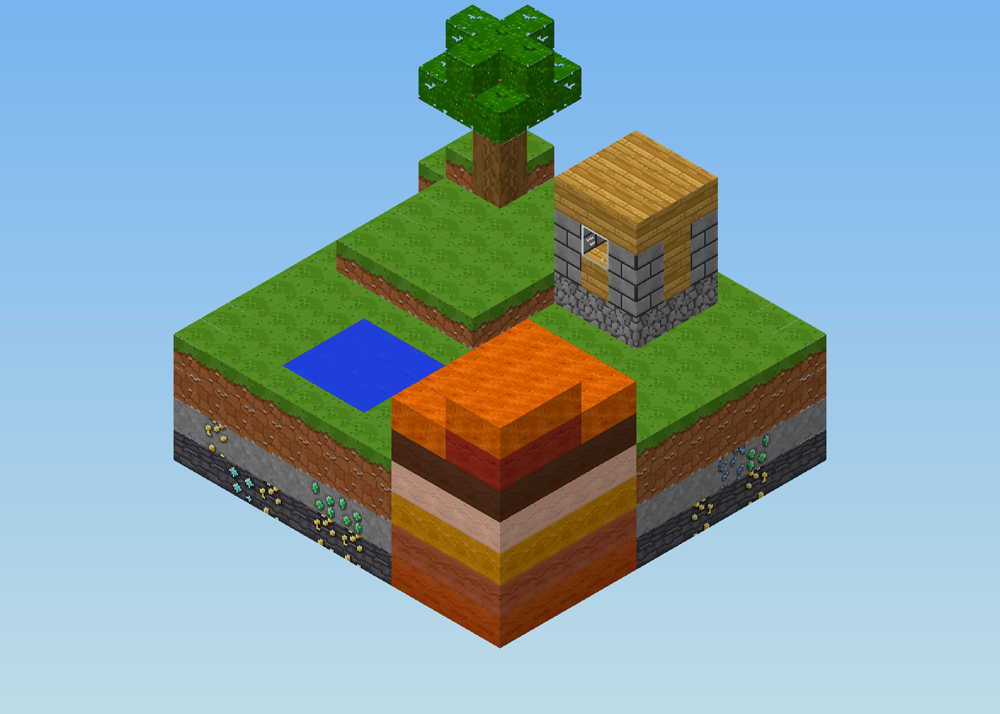
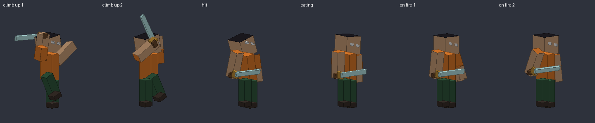

# Nabd — Bright Textures & Living Animations

**Nabd** (Arabic for *pulse*) is a complete, hand-crafted look for Minecraft Bedrock:
clean cartoon textures with real depth, a full set of new player animations, and clear nights.
Every texture is drawn from scratch — nothing is copied from other packs.

## ✨ Textures
- **All ores redrawn** for stone and deepslate, with a soft shimmer. Diamond and emerald are a few big, readable gems.
- **Darker deepslate** drawn as stacked slate plates, the whole family matched.
- **Terrain:** grass, dirt, stone, cobblestone (pebbles), gravel, sand, tall-grass clumps.
- **Badlands:** natural sediment lines in every terracotta colour, sandstone and red sandstone.
- **Nether & End:** netherrack, soul sand and soil, blackstone and basalt families, crying obsidian with glowing cracks, end stone, quartz, amethyst, animated sculk.
- **Building blocks:** stone bricks (all variants), bricks, planks, concrete, wool, and more.

## 🏃 Animations (stateless — work on every recent game version)
- Walking, sprinting, walking backwards and sidesteps with natural arm and hip motion.
- Running jump, falling and hard landing poses.
- Smooth crouch (the head stays in place), crouch-walk sway.
- Small steps when turning on the spot, idle weight shift, breathing.
- **Attacks by weapon:** sword slash, axe overhead chop, pickaxe/shovel/hoe digging strike, punch — in first and third person.
- Climbing ladders and vines, flinch when hit, chewing while eating, panic arms when on fire.
- Full-circle swimming stroke.

## 🌙 Night sight
Clear nights with a toggle: run `/nabd:settings` to switch it on or off.

## ⚙️ Options (Global Resources → Nabd → settings)
- Nabd items + animations *(default)*
- Nabd items, no animations
- Game items + animations
- Game items, no animations

## 🤝 Compatibility
Nabd replaces only the standard player animations. If another add-on replaces the same animations, pick a "no animations" option and the rest of the pack still works.

## 📦 Install
1. Download `Nabd_vX.mcaddon` and open it — Minecraft imports both packs.
2. Activate **Nabd** in *Global Resources* (or in the world's resource packs).
3. For night sight, also turn on the **Nabd** behaviour pack in the world.

Requires Minecraft Bedrock **1.21.120** or newer.
